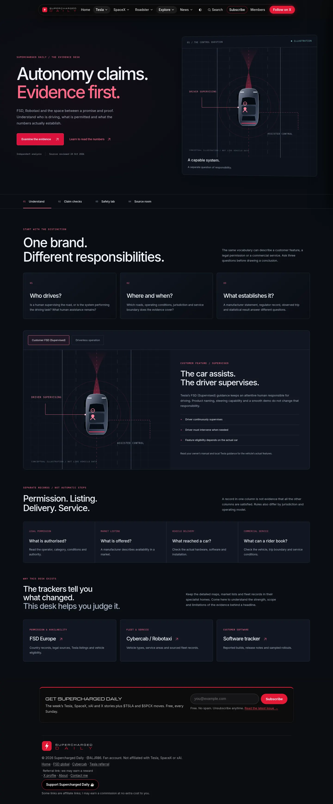
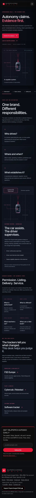
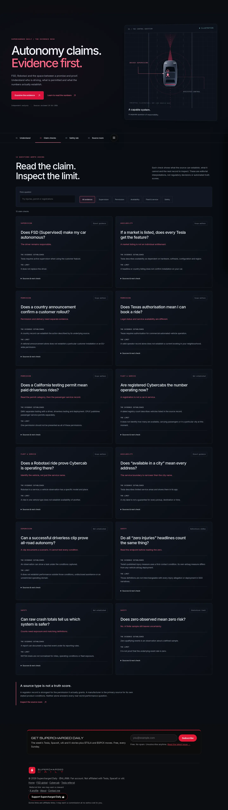
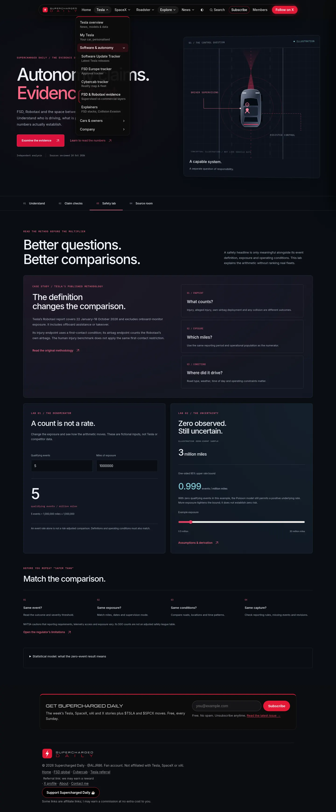
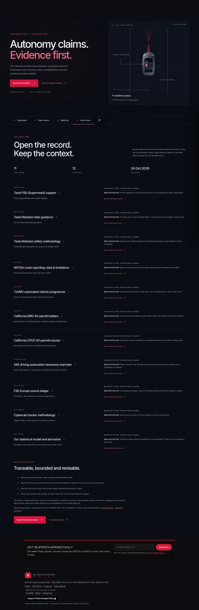

# FSD & Robotaxi evidence desk

## Decision: keep it, give it a distinct job

The original `/autonomy.html` repeated global FSD markets, EU countries, Robotaxi cities and promises. It read legacy rollout flags, described Dallas as a future city after Tesla's current guidance listed service there, and depended on a successful promises fetch before rendering any of its main evidence tables. Without JavaScript it had very little substantive content.

The redesigned page is the site's **evidence interpretation desk**. It helps a reader decide what a claim establishes and where its limits lie. Changing geography, releases, counts and product details remain on their specialist trackers. This gives the page a useful purpose and avoids maintaining another competing city/market list.

## Experience

Four sections:

1. **Understand:** three questions (who drives, where/when, what establishes it), an original illustrated comparison of supervised assistance and conceptual driverless operation, four independent evidence categories, and direct tracker handoffs.
2. **Claim checks:** 12 searchable/category-filtered editorial checks. Each contains an answer, evidence scope, limitations, source references, review date and next action. Direct links open the relevant card.
3. **Safety lab:** Tesla methodology case study, event-rate arithmetic, a zero-event exposure slider, comparison checklist and explicit statistical assumptions.
4. **Source room:** 11 source records with source type, scope, review date, publication-date availability, limitations and links to related claims.

Original SVG graphics, custom link arrows, responsive grid/card system, consistent headings, scoped dark/light themes and reduced motion. Diagrams describe roles; they are not live telemetry, actual perception output or product certification. Global logo, navigation, member integration and newsletter remain in the site shell.

## Evidence and editorial scope

`data/autonomy-evidence.json` is curated source material, not a scraped real-time feed. Source and claim IDs are stable; the model validates IDs, dates, references and URL schemes. The builder renders the full page and search-index entries. Review dates are retained exactly and do not advance on a rebuild.

Primary sources reviewed on 24 October 2026:

- Tesla FSD (Supervised) product guidance: responsibilities and configuration-dependent features.
- Tesla Robotaxi rider guidance: limited service areas and app-based availability.
- Tesla Robotaxi safety methodology: report period, onboard-monitor exclusions, offboard assistance/takeover and endpoint definitions.
- NHTSA SGO overview/data limitations: reporting differences, exposure and normalization limits.
- Texas DMV AV programme: commercial authorisation requirements.
- California DMV permit categories and CPUC passenger-service permit records.
- SAE's freely accessible taxonomy overview. The paid standard was not purchased, and a Tesla automation-level certification is not inferred.

The existing FSD Europe and Cybercab source ledgers are linked as **Site tracker** records with their existing 23 October review dates. They are visibly distinguished from primary sources. Exact URLs, limitations and individual dates are in the JSON and on the page.

The safety case study attributes Tesla's own methodology. It does not call all injury definitions equivalent, assign blame from a crash count or turn a manufacturer report into an independent audit. No real-fleet safety ranking was added.

## Statistical lab

The event-rate calculation is `events / miles * 1,000,000`, with finite positive exposure and a nonnegative integer event count. Blank, negative, fractional-event and nonfinite values produce an input message, rather than a misleading zero.

For **zero events only**, with a Poisson count, constant rate λ, fixed exposure E and complete event ascertainment:

`P(N=0) = exp(-λE)`

The one-sided 95% upper rate bound is `-ln(0.05)/E`, approximately `2.995732/E`. The slider converts that to events per million miles. Inputs are explicitly fictional, not Tesla or competitor data. It is not a posterior probability, general confidence-interval calculator, causal model or an estimate of an individual trip's risk.

## Files and refresh

- `autonomy-evidence-model.js`: validation, filtering, input rules and arithmetic.
- `autonomy-evidence-view.js`: shared card/source/diagram/calculator rendering.
- `autonomy-evidence.js`: hash routing, filters, source-to-claim navigation, role switch and lab controls.
- `autonomy-evidence.css`: isolated styles, existing Inter/IBM Plex Mono families.
- `scripts/build-autonomy-evidence.mjs`: saved semantic HTML and local search entries.
- `data/autonomy-evidence.json`: editable evidence and source records.

Run `node scripts/build-autonomy-evidence.mjs`, then the existing bundle/injection build. The homepage build calls the builder through `build-noscript.mjs`; source/style/builder changes trigger that workflow. `autonomy.html` and `data/pages.json` already belong to its commit list.

An editorial source review is still required when guidance or methodology changes. Automated availability/count updates remain on the specialist trackers. The desk makes no per-visitor regulator, Tesla, promises or location request. Its content is embedded in the saved page; there is no runtime JSON dependency.

`sd-autonomy-evidence-v1` stores only the last topic filter, locally. It is optional and not account sync. The lab inputs are not stored or sent anywhere. No new backend, SQL, paid tool or authentication setup.

Without JavaScript or with the page bundle blocked, all four sections and source records remain visible; inactive interactive controls are hidden. Illustrative default arithmetic and both role explanations remain readable.

## SEO and validation

Page-specific metadata, canonical, original 1200×630 social graphic, CollectionPage JSON-LD and source/claim anchor links. The old Dataset claim was replaced because the new destination is a curated guide, not a primary dataset. Four focused local search records link to the overview, checks, safety and source room. Search appearance/ranking is not guaranteed.

- Six Node tests: source/date/reference validation; topic filtering; event-rate input rules; exact zero-event formula; escaping and SVG IDs; deterministic semantic build.
- Twenty-six browser cases: four sections at 320/390/768/1440 px; role switch; filters and no-results state; source-to-claim navigation; deep links; keyboard range; invalid input; light theme; no JS; blocked bundle/storage; malformed preferences/hash.
- Shared bundle/snapshot tests remain required. New GitHub workflow runs the focused Node/browser suite.

## Previews

## Later human decisions

A recurring editorial review cadence and independently audited exposure data would strengthen the desk further. No automated safety rating or paid data feed was assumed. Expanding this into comparative research would require matching endpoints, operating conditions, reporting capture and exposure before drawing a conclusion.
