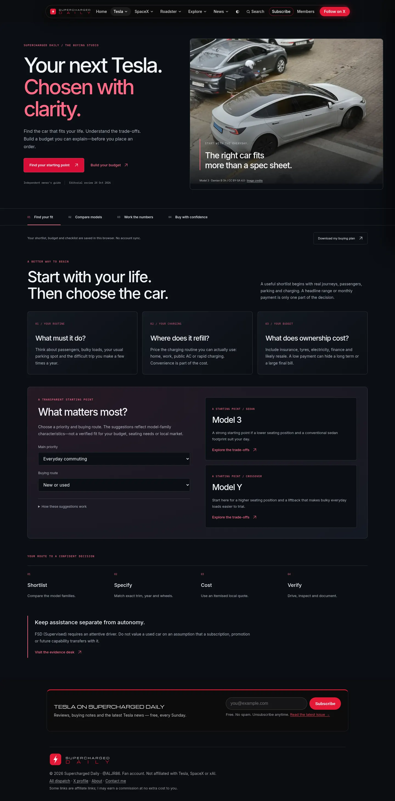
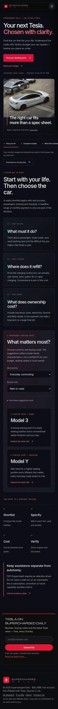
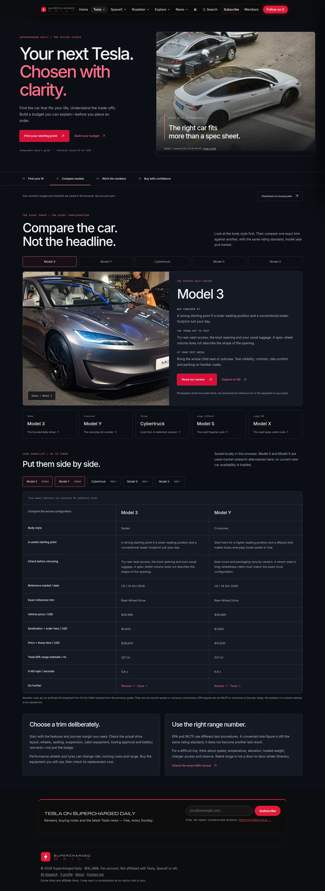
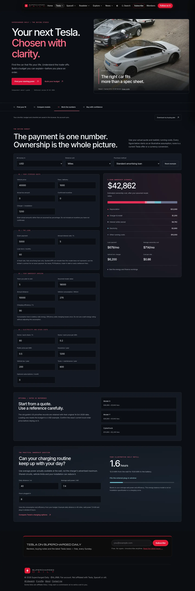
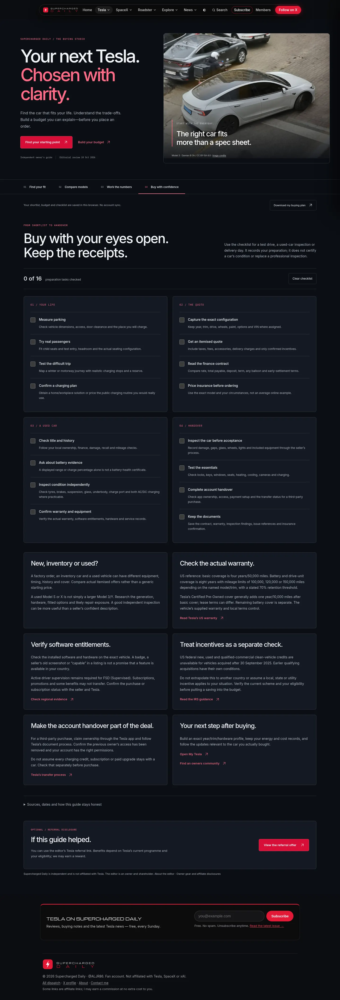

# Tesla buying studio

Complete overhaul of `/guides/tesla-buying-guide.html` into four sections: **Find your fit, Compare models, Work the numbers, Buy with confidence**.

## Problem and result

The old article combined US prices labelled as applying anywhere, a narrow three-car cash sheet, generic trim advice and referral links. The new guide helps readers build a shortlist, identify a precise vehicle, cost their own scenario and prepare for inspection/handover.

- Five model-family profiles, with trade-offs and test-drive prompts. Model S/X are used-market research alternatives; no current new-car availability is asserted.
- Transparent priority/route suggestions: a simple disclosed sort, not a verified fit or opaque recommendation score.
- Up to three saved model comparisons. Every numeric column uses one exact archived US trim; no base-price/performance-trim mixing.
- Cash or fully amortising loan ownership model, energy-cost estimate and daily charging planner.
- Sixteen saved preparation tasks and a downloadable plain-text plan containing assumptions and completed tasks.
- Responsive visual system, original cost diagrams, existing licensed photography, dark/light themes, visible focus, reduced motion and mobile inputs sized to avoid iOS zoom. A compact mobile budget summary stays visible while editing.

## Data dates and source limits

Editorial guidance was reviewed 24 October 2026. The three numeric US references retain **14 October 2026**, the original guide's snapshot date. They were not relabelled as newly verified current quotes. Tesla's public configurators were not fully readable in the available direct extraction during this build; search results corroborated some figures but did not establish a complete fresh like-for-like snapshot. Current local checkout remains the final price/equipment check.

The old trim-specific towing/cargo/charger-price table was removed to avoid perpetuating mixed or unverified configuration assumptions. The archived comparison keeps vehicle price, destination/order fees, EPA estimate and 0–60 mph for the named US trim. Photographs can show a different trim and are labelled accordingly. No currency conversion or live inventory feed is implied.

Guidance sources: Tesla vehicle warranty, home charging, FSD (Supervised), app ownership transfer, IRS clean-vehicle credits, EPA/DOE rating lookup. Exact URLs, review dates and scope notes are in `data/buying-studio.json` and the page disclosure. US warranty examples are not global terms. Incentives are not assumed; the calculator starts with zero.

## Model and calculations

`buying-studio-model.js` is shared by saved/browser rendering. `buying-studio-view.js` renders profiles, comparisons, financial results, charging and checklist/report content. `buying-studio.js` controls routes and local preferences.

Acquisition = vehicle price + fees + actual tax amount − confirmed incentive.

Loan payment uses a fixed annual interest rate divided by 12, a fixed term and no balloon. Zero-interest loans use principal/term. For ownership shorter than the term, the model computes the outstanding balance and only the interest paid during ownership. It does not charge all future interest or count principal twice.

Ownership cost = acquisition − assumed resale + charger/install + interest paid during ownership + electricity/insurance/tax/maintenance/subscriptions during ownership.

A deposit reduces borrowing; it is not a discount. The average monthly ownership figure is not a monthly bill. Remaining loan balance and resale less that balance are shown in the workings. This simplified depreciation model does not allow resale above acquisition cost.

Annual battery energy = annual distance × vehicle-side consumption / 1,000. Wall energy divides by charging efficiency once. Blended tariff weights home/work and public shares. Do not feed a wall-energy consumption rating into this vehicle-side calculation without adjusting the efficiency assumption.

Daily charging time = daily battery energy / charging efficiency / entered average wall power. This is an energy-balance model, not a charging curve or installation specification. Actual power must account for the car, circuit and shared supply. Use an appropriately qualified installer.

Finance limitations are visible beside the fields: the entered rate is a simple nominal annual rate; a lender's APR/fees may not map to this calculation. No leases, PCP/balloons, negative trade equity, early-settlement fees, inflation, opportunity cost or unentered repairs are modeled. Costs, annual usage, tariffs and resale are assumptions, not forecasts.

Changing currency resets budget amounts to a labelled illustrative example, with a visible message; it never silently applies an exchange rate. Changing distance units converts both distance and consumption to preserve physical energy. Optional archived reference buttons reset to USD assumptions with the original date shown.

## Persistence, privacy and fallback

`sd-buying-studio-v1` stores the selected model, shortlist, priority, buying route, checklist and budget assumptions in this browser. No Supabase/account sync, VIN, Tesla account access or new permission. Saved incomplete numeric fields remain incomplete after reload, rather than silently becoming default estimates. Blocked storage keeps the plan usable for the visit.

The plan download is generated locally as `my-tesla-buying-plan.txt`; it includes the entered financial assumptions. It is not uploaded. The local studio storage does not modify My Tesla or the personal homepage.

All four sections, source explanations, default comparison and a worked budget remain in semantic saved HTML without JavaScript or with the page bundle blocked. Inactive inputs are hidden. Existing `?car=m3|my|ct` and `#buy-calc` links work; source and warranty anchors open the right section. Saved checklist labels remain readable without JavaScript.

## Build, search and SEO

`node scripts/build-buying-studio.mjs` reads `data/buying-studio.json`, renders the page and updates four focused local search records while preserving unrelated index order. It is integrated into `build-noscript.mjs` and the existing homepage build's input list. Existing commit rules already include guide HTML and `data/pages.json`.

The old `guides/buy-calc.js/css` stay in the repository but are no longer loaded on this page. Only the `buy-guide` bundle changes. The site shell, member integration, logo/fonts, newsletter and disclosed optional referral remain. The referral is separated from the primary planning actions.

Updated title/description, canonical and WebPage JSON-LD. No Product/Offer price markup or unsupported rating/FAQ claims. Search ranking is not guaranteed.

## Media attribution

All existing photos are cropped/resized derivatives under CC BY-SA 4.0, with source links on the page:

- Hero: [Damian B Oh](https://commons.wikimedia.org/wiki/File:Tesla_Model_3_Highland_Pearl_White_Multi-Coat_(3).jpg).
- Model 3: [Ethan Llamas](https://commons.wikimedia.org/wiki/File:Tesla_Model_3_Highland_Performance_Quicksilver_01.jpg).
- Model Y: [Damian B Oh](https://commons.wikimedia.org/wiki/File:Tesla_Model_Y_Dual_Motor_First_Edition_Juniper_Quicksilver_(8).jpg).
- Model X: [Ethan Llamas](https://commons.wikimedia.org/wiki/File:Tesla_Model_X_Plaid_Shadow_Grey_01.jpg).
- Model S: [Correlated alembic](https://commons.wikimedia.org/wiki/File:Tesla_Model_S_2024_Blue.jpg).
- Cybertruck: [Dllu](https://commons.wikimedia.org/wiki/File:Foundation_series_Cybertruck_at_dusk_in_San_Jose_dllu_(cropped).jpg).

## Validation and previews

Seven model/build tests cover independent monthly-loan ledger reconciliation, zero-rate/cash equivalence, energy and unit conversion, invalid/saved fields, exact references, export and deterministic saved HTML/search ordering. Browser cases cover four sections at 320/390/768/1440 px, suggestions, shortlist limits, finance/cash, unit/currency changes, invalid inputs and reload, archived-reference resets, charging, checklist persistence, download, light theme, no JS, blocked bundle/storage and deep links. Shared bundle/snapshot and explainer index checks are required.

## Future human decisions

A complete fresh price/spec reference needs editorial verification of an exact local configuration. No paid feed or unofficial inventory source was added. Additional countries, lease/PCP calculations and account sync require separate source/model/schema decisions. The current guide needs no SQL or external setup.
