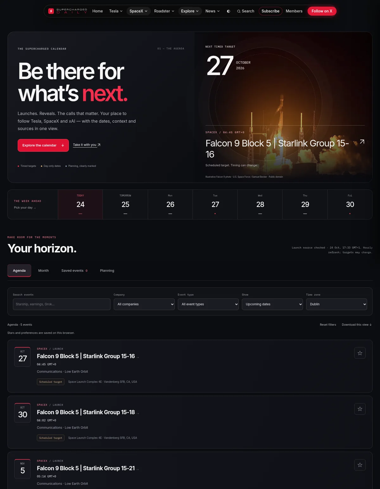
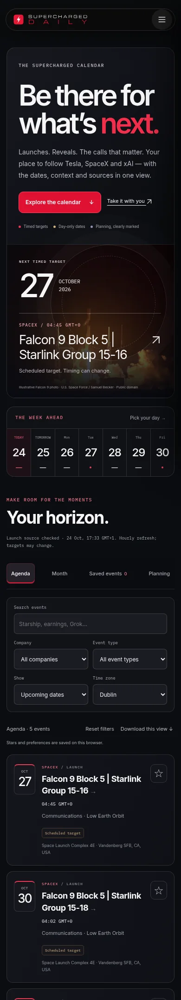
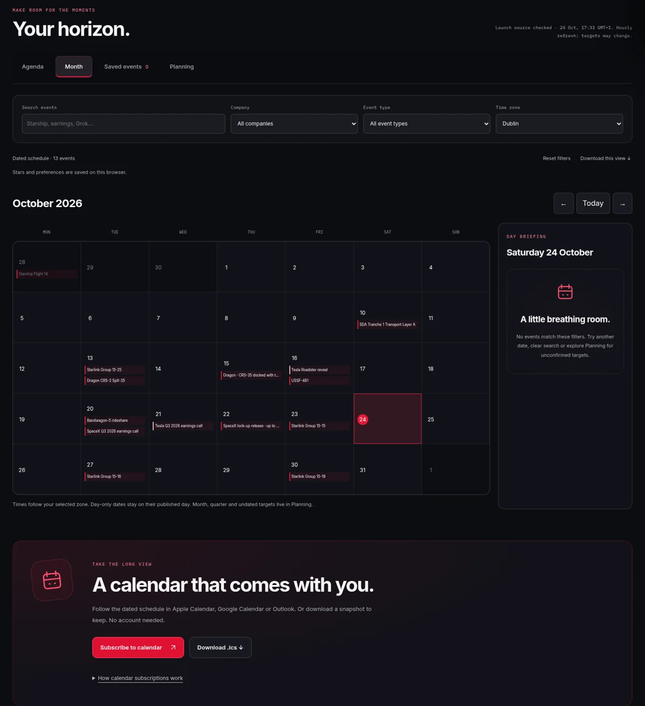
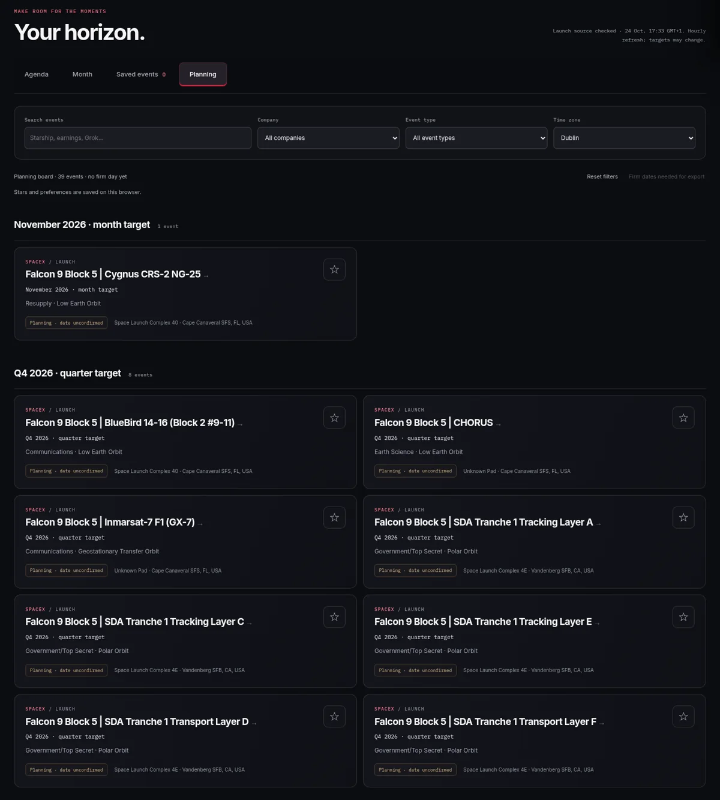

# Calendar studio

Calendar is now a date-led destination for launches, earnings, reveals and releases, using the existing Supercharged Daily brand, navigation, Inter / IBM Plex Mono fonts and crimson palette.

## The experience

- A large next-target feature with a responsive, attributed Falcon 9 photograph and a seven-day event strip. The image illustrates launches; it does not depict the featured mission.
- Agenda, Monday-first month grid, saved events and a separate planning board grouped by timing precision. Search, company, event type, date range and time zone controls work together. Tabs stay within reach while browsing long lists.
- An event briefing with timing precision, source status, launch window when available, context and actual recorded coverage/source links. Broadcast start times never replace launch/occurrence times.
- Browser-local stars and preferences persist between visits. They are not account-synced. Blocked storage degrades to session-only controls with a visible message.
- Per-event, current-view and saved-event ICS downloads, plus a public subscription feed at `/data/calendar.ics`. No registration, paid dependency or SQL migration.
- Complete saved semantic HTML and inline data. The dated agenda, grouped planning records and expandable past archive remain readable with JavaScript disabled or the new bundle blocked. A failed/malformed/older data fetch preserves the saved page. Launch freshness is visible.
- Updated title, description, Open Graph and Twitter copy. Provisional targets are not promoted into rich-event schema or marked completed by an elapsed clock.

## Data and update flow

1. `.github/workflows/launches-refresh.yml` runs hourly at :17, or manually. `scripts/fetch-launches.py` makes one free LL2 request to the supported v2.3 plural `/launches/upcoming/` endpoint. The previous v2.2 endpoint is unsupported. No Calendar visitor calls the rate-limited provider.
2. The importer validates the payload/provider/identities/timestamps and atomically replaces the compact cache only after success. Errors fail the job and retain the last good file. Its compact fields remain compatible with other site pages. `checked` and `updated` record a successful source check, not proof that every date changed.
3. The same job runs `node scripts/build-calendar-studio.mjs` and publishes the saved page, normalized JSON and ICS feed together. A checked heartbeat can produce an hourly commit even if targets are unchanged.
4. The regular homepage build also calls the Calendar builder through `scripts/build-noscript.mjs` when editorial inputs change. The generated files are included in that workflow’s commit list.
5. The builder extracts the existing `CURATED` and `WATCHING` arrays from `calendar.js`, applies `data/events.json`, merges the compact launch cache and attaches `live-data.json` coverage links. There is one normalized model for saved HTML, browser views and ICS. The old shared `calendar.js` and `calendar-merge.js` are unchanged for other pages.

Edit firm editorial event facts in **`data/events.json`**. Retain stable IDs, explicit precision and real source URLs. Curated fallback/watchlist entries remain in **`calendar.js`**. Run `node scripts/build-calendar-studio.mjs`, `node scripts/build-js.mjs`, and `python scripts/inject-js-bundles.py` after source edits.

The source is an upcoming-launch sample (up to 40 requested records) plus an editorial archive, not an exhaustive launch database. Legacy cache pruning of holds and stale unsupported targets is preserved for other consumers. Editorial dates and unlinked watchlist claims need human review; this redesign does not independently certify every inherited claim.

## Timing and export rules

- Timed instants convert with IANA time zones and daylight-saving rules. Day-only dates never shift across zones and have no fabricated clock/countdown.
- Month, quarter, half-year, year and undated targets stay in Planning and are excluded from daily grids/ICS. Provider placeholder timestamps never become exact launch dates.
- “NET” means no earlier than. A clock passing produces “Target passed · awaiting update”; completion/in-progress states require a source status.
- Exact mission identities prevent similar names such as Rivada 1 / 10 / 11 collapsing together. Launches and docking are distinct. Stable ICS UIDs do not include the scheduled date, so rescheduling keeps identity.
- ICS uses UTC timed starts, all-day VALUE=DATE with exclusive next-day ends, escaped text, CRLF and UTF-8 75-octet folding. Future targets are tentative. No duration is fabricated where the source has none.
- Downloads are snapshots. Calendar subscriptions refresh on the client’s schedule, not instantly; notification settings belong to the calendar app. The website does not send event alerts.

## Validation and previews

- 13 model/export/build checks: day precision, UTC/DST, elapsed-target honesty, coarse planning, leap-month geometry, seven-day boundaries, current-month exports, mission identity, manual rescheduling versus broadcast clocks, company classification, ICS escaping/folding/stable IDs, all-day boundaries, malformed preferences and reproducible saved output.
- 3 importer checks: actual compact v2.3 fixture compatibility, bad-payload retention and mixed-provider rejection.
- Shared calendar deduplication and launch-consistency regressions pass. Bundle build/publisher regressions pass.
- Browser journeys at 320, 390, 768 and 1440 pixels cover all four views, stars/reload, details, link copying, real ICS downloads, time zone changes, arrow-key month navigation, day-only targets and no horizontal overflow. Additional light theme, no-JS, blocked-bundle, malformed preferences, blocked storage, failed/malformed/older source cases are covered. Third-party browser traffic is blocked in tests.
- `calendar-studio-checks.yml` repeats the relevant checks in CI and verifies committed HTML/JSON/ICS/bundle reproducibility. It uploads browser screenshots as an artifact.

## Follow-up decisions

Review unlinked editorial watchlist items against primary sources, and keep them unconfirmed until that is done. A complete historical launch archive would need a separate ingest and coverage policy. Account-synced stars, personalized subscription feeds and email/push reminders would need product and backend decisions; none are implied by this release. No paid service is required for the shipped features.

References: [LL2 documentation and supported versions](https://ll.thespacedevs.com/docs/), [Next Spaceflight calendar](https://www.nextspaceflight.com/launches/), [iCalendar RFC 5545](https://www.rfc-editor.org/rfc/rfc5545).
