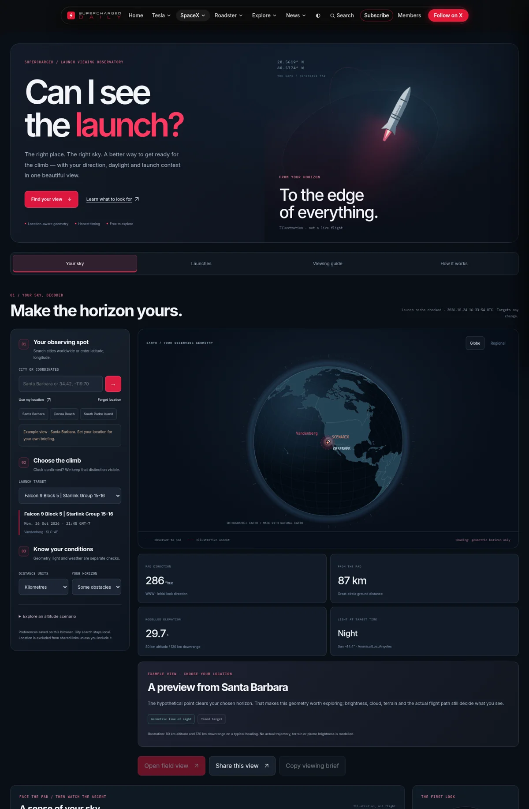
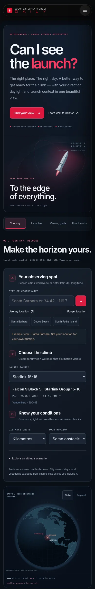
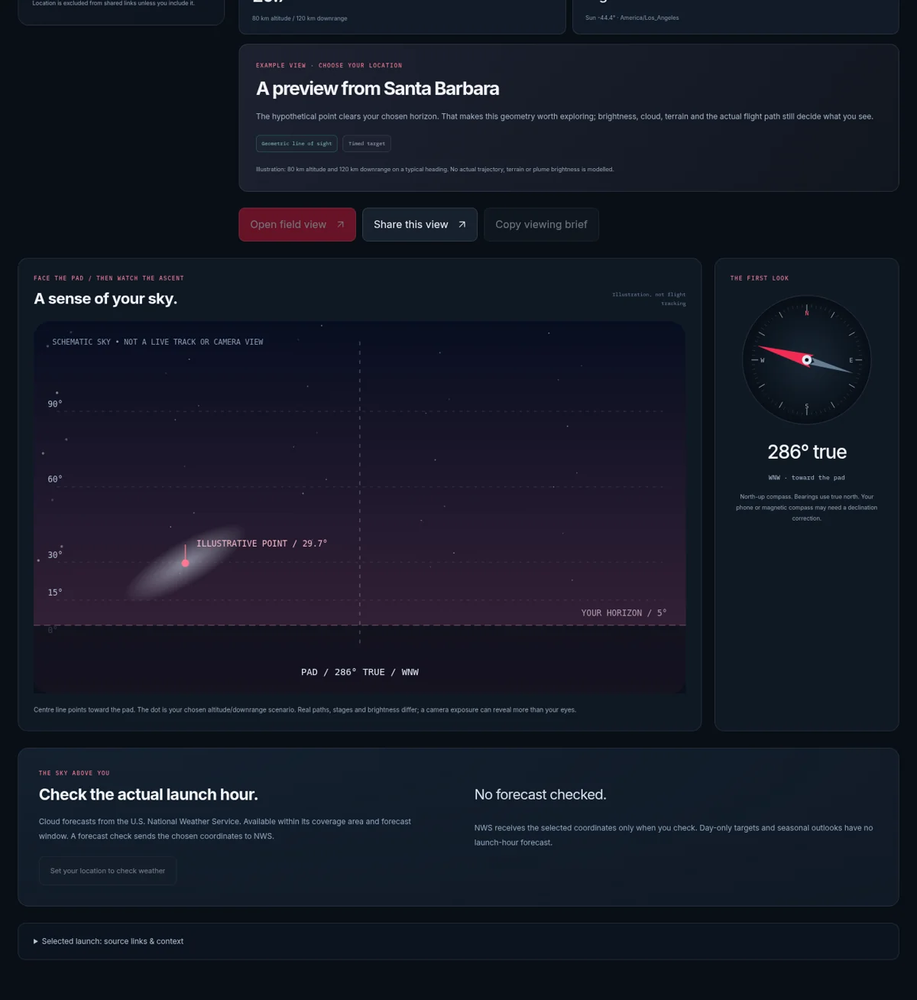
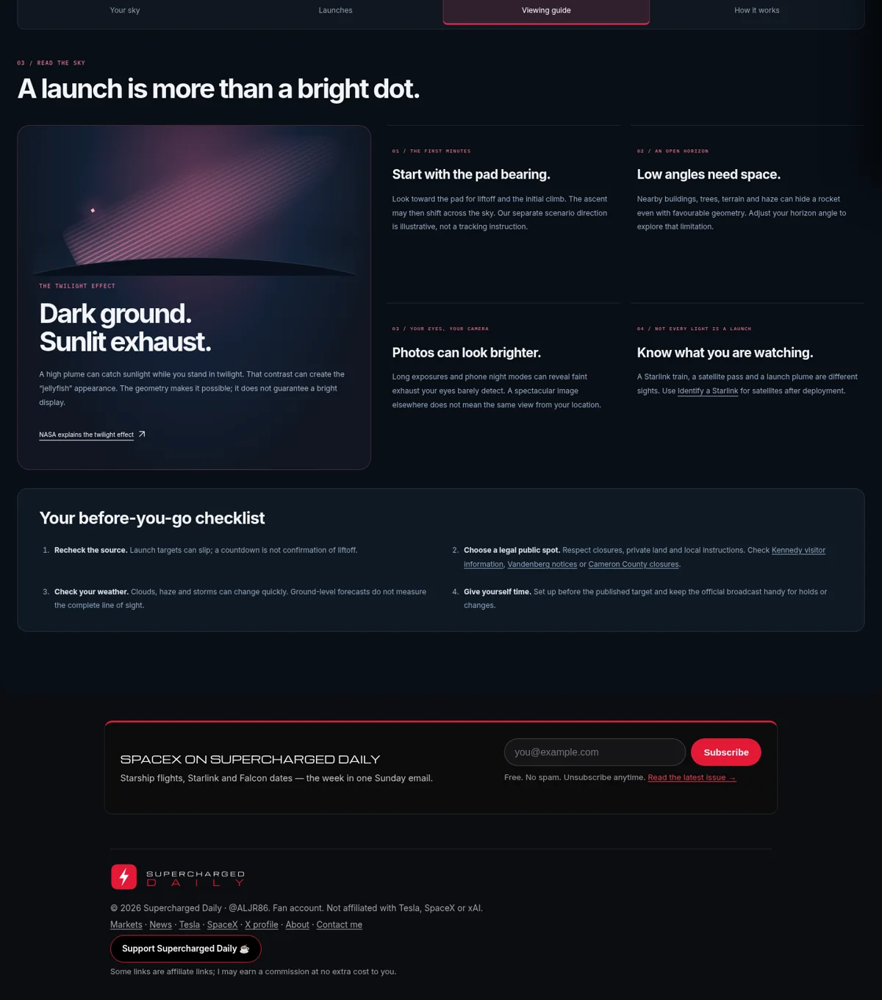

# Launch viewing observatory

`see-the-launch.html` is now a complete location-aware launch-viewing workspace. It preserves the site’s logo, navigation, Inter / IBM Plex Mono typography and crimson brand accents, with a new dark observatory visual system.

## What changed and why

- A new illustrated launch hero, persistent four-section navigation, a globe and regional map, an adjustable horizon/sky illustration and a large compass. The graphics are local SVG, not video, a camera feed or live telemetry.
- Your sky, Launches, Viewing guide and How it works separate planning, browsing and explanation. Location, mission and conditions form a three-step planner. Location presets remain usable if the full city catalogue cannot load.
- City search runs against a local GeoNames subset: 12,995 records in this snapshot, plus the existing launch-region presets. It supports names, ASCII aliases, country/state disambiguation, coordinates and keyboard selection. The roughly 981 KB JSON catalogue loads on search, not on first paint. There is no third-party geocoding request.
- Saved location and preferences migrate from the previous browser key, survive reloads, and degrade to session-only behavior when storage is blocked. Geolocation remains an explicit action; denied/in-app permissions have a city/coordinate fallback. No accounts or SQL migration are required.
- A dedicated field dialog provides a large true pad bearing, launch time, a dim red display and an optional phone-heading cue. It does not track the rocket. Compass permission/listeners are opt-in and are removed when the dialog closes. Magnetic declination and sensor errors are explicitly distinguished from the true bearing.
- Sharing excludes location by default. A separate checkbox includes coordinates rounded to two decimals, roughly a kilometre. Received coordinates are validated and removed from the address bar after loading. Copying a full observing brief is also an explicit action.
- Updated description/social metadata and complete saved semantic HTML: launch records, sources, the illustrative map, guide and method remain readable when JavaScript is disabled or the new bundle is blocked. A failed/malformed/older local data fetch retains the saved snapshot and labels freshness.

## Accuracy fixes

The former implementation guessed night-time from the visitor’s local clock hour when weather was missing, used vehicle/distance thresholds for Likely/Maybe/No labels, and could substitute a seasonal outlook for a launch-hour forecast. Those rules are not used by the new observatory.

The new model separates four questions:

1. **Where is the pad?** Great-circle distance and the initial true bearing come from observer and pad coordinates. Santa Barbara’s bearing to Vandenberg is about **286°**, while a hypothetical downrange point can be about **226°**. These are separate directions. Unknown pads stay unknown rather than defaulting to Cape Canaveral.
2. **What clears the horizon in this scenario?** A hypothetical point is placed at the selected altitude and downrange distance on a typical heading. Spherical-Earth geometry calculates its elevation and the footprint that clears the chosen obstruction angle. These are geometric labels, never probabilities or an actual mission trajectory.
3. **What is the light at that instant and location?** Approximate solar position uses UTC and observing coordinates, independently of the device’s time zone. Day-only launch targets receive no daylight estimate from their placeholder clock. The model also exposes sunlit-point geometry; illumination alone does not predict plume brightness.
4. **Does a forecast cover that exact target?** NWS sky-cover and precipitation values are selected only from an interval that actually contains the launch instant. Missing forecasts remain unknown. Zero cloud cover is a valid value; missing data never becomes zero. Older forecasts are labelled. Changing location or mission clears the forecast; outdated asynchronous responses cannot overwrite a new selection.

For Earth radius `R`, target altitude `h`, ground distance `d` and central angle `δ = d/R`, elevation is `atan2((R+h) cos δ − R, (R+h) sin δ)`. The footprint for minimum elevation `α` is `R × [acos(R/(R+h) cos α) − α]`. These assume a spherical Earth and a sea-level observer.

**Not modelled:** actual launch trajectories or doglegs, terrain and observer altitude, atmospheric refraction, stage burn timing, vehicle attitude, brightness, cloud along the entire line of sight or rocket noise. The coloured footprint is not a visibility-probability map. Real trajectories, conditions and observations may differ substantially.

## Data and refresh flow

- `data/calendar-studio.json` is the launch/date source. Only dated SpaceX launch events enter this tool. Existing editorial date overrides, source precision and stable event IDs remain shared with the Calendar. Month/quarter/year plans stay out of the viewing slate.
- `see-the-launch-data.js` supplies pad coordinates and launch-region presets only. Its legacy fallback mission list and `see-the-launch.js` / `.css` are not loaded by the new page. Edit mission dates in `data/events.json` and the existing Calendar source, not that fallback list.
- `node scripts/build-launch-viewing.mjs` builds `data/launch-viewing.json` and the complete saved page from the same model/view used by the browser. The builder uses the source-check time for deterministic saved output.
- `scripts/build-noscript.mjs` calls the builder after the Calendar builder. The hourly launch-refresh workflow rebuilds and commits both tools together. The regular editorial build also publishes the viewing JSON and HTML. A failed refresh leaves previously committed data available; freshness stays visible.
- Visitors request the site’s own viewing snapshot. They never request Launch Library 2 directly. Existing shared Calendar/launch code and other bundles retain their behavior.

## Free resources and coverage

The shipped features need no paid service, account key or external map-tile host.

- **Weather:** [U.S. National Weather Service API](https://www.weather.gov/documentation/services-web-api), documented as free open data for any purpose. An explicit forecast check requests `/points/{lat},{lon}` and its returned `forecastGridData` URL. Responses are cached in memory for 15 minutes. Its coverage and forecast window are limited; outside them the tool shows unknown conditions. No seasonal outlook is used as an hourly forecast.
- The old free Open-Meteo endpoints were removed from this page’s runtime. [Open-Meteo’s free API terms](https://open-meteo.com/en/terms) restrict commercial use; a global commercial subscription would be a separate owner decision. We have not subscribed to anything or assumed that entitlement.
- **Cities:** [GeoNames cities15000 download and format](https://download.geonames.org/export/dump/readme.txt), [CC BY 4.0](https://creativecommons.org/licenses/by/4.0/). Modified by retaining cities of 50,000+, capitals and additional California/Florida/Texas records; selecting fields; rounding coordinates to four decimals; and sorting by population. Small launch-region presets supplement this subset. This is not a complete address, ZIP-code or small-town geocoder.
- **Map:** [Natural Earth](https://www.naturalearthdata.com/about/terms-of-use/), public domain, 1:110m country geometries. Properties removed and coordinates rounded to two decimals. Geographic boundaries are illustrative cartography, not navigation guidance.
- **Projection:** D3 Geo 3.1.1 with tree-shaken MIT dependencies, vendored in `vendor/launch-geo.js`. Full notices are in `vendor/launch-geo-NOTICES.txt`; the runtime does not fetch a CDN or install a package.
- **Science references:** [NOAA solar calculation notes](https://gml.noaa.gov/grad/solcalc/calcdetails.html) and [NASA’s explanation of sunlit exhaust in a darker sky](https://science.nasa.gov/image-article/apod-2024-march-12-a-galaxy-shaped-rocket-exhaust-spiral/). Calculations and illustrations are our own recreational model; neither agency endorses the tool. No third-party APOD photograph is reused.
- UX reference inspected: [Plume](https://plume.watch/) provides a compact location-based heuristic slate. [Flight Club](https://flightclub.io/) is a trajectory-oriented reference; its public fetch is JavaScript-only, so this review does not claim a full feature audit of it.

The city/map source snapshot was downloaded on 24 October 2026. To refresh the local assets, download the primary GeoNames ZIP and Natural Earth `ne_110m_admin_0_countries.geojson`, then run:

```sh
python scripts/build-viewing-assets.py --cities /path/cities15000.zip --world /path/ne_110m_admin_0_countries.geojson --as-of YYYY-MM-DD
node scripts/build-launch-viewing.mjs
node scripts/build-js.mjs
python scripts/inject-js-bundles.py
```

## Validation

- **14 model/build checks:** great-circle edge cases, pad-versus-downrange bearings, spherical horizon/obstruction geometry, date-line destinations, UTC solar position, day-only timing, malformed coordinates/preferences, unknown pads, elapsed targets, exact forecast intervals, missing/zero/stale weather, city matching, finite/escaped graphics and reproducible saved output.
- **28 browser cases:** four views at 320/390/768/1440 pixels, globe/regional switching, persistent preferences, private/rounded sharing, clipboard, field/red mode, forecast response/selection clearing, day-only targets, denied geolocation, local global-city search, coordinate input, light theme, no-JS/blocked bundle, bad preferences, blocked storage, legacy preferences, failed/malformed/older snapshots, failed/out-of-range forecasts and an explicit shared-location URL. No page errors or horizontal overflow. Browser tests route public fixtures locally and never write to an external service.
- Shared Calendar deduplication, launch-consistency and bundle/publisher regressions pass. A successful real NWS points/grid fetch was used to verify the adapter shape; browser tests do not depend on network or future launch dates.
- `launch-viewing-checks.yml` repeats the tests in CI, verifies committed generated files/bundle and uploads browser screenshots. Existing repository suites also run against the final branch.






## Later decisions

A mission-specific trajectory feed, calibrated true-north phone guidance, worldwide commercial weather coverage, terrain-aware obstruction profiles and automated alerts need their own source/product decisions. They are not implied by this release. Review source precision before travel and use official local closure/visitor information. Refresh the city/map subset periodically if broader place coverage is needed.
