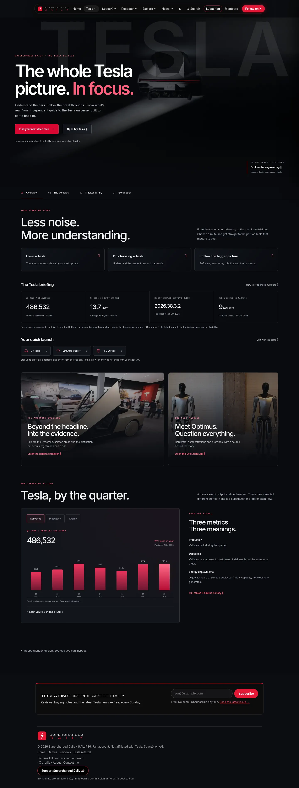
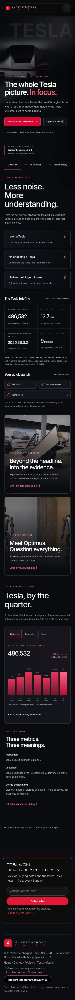
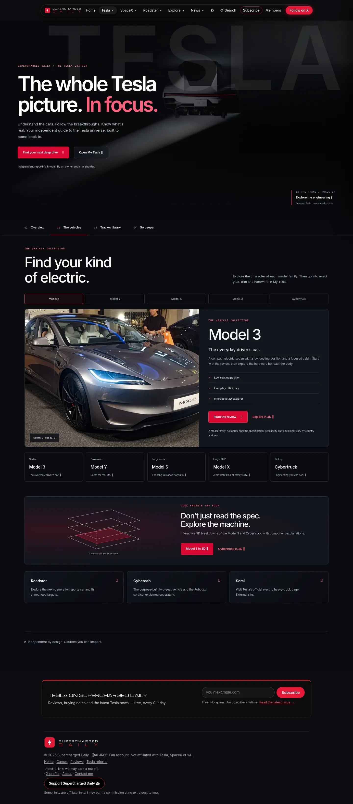
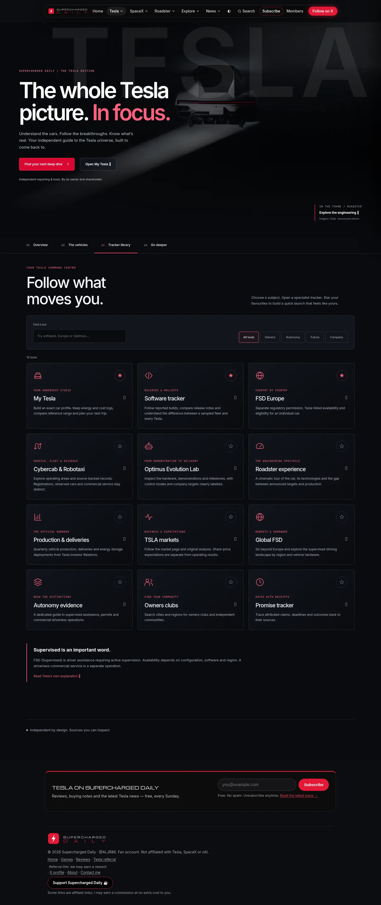
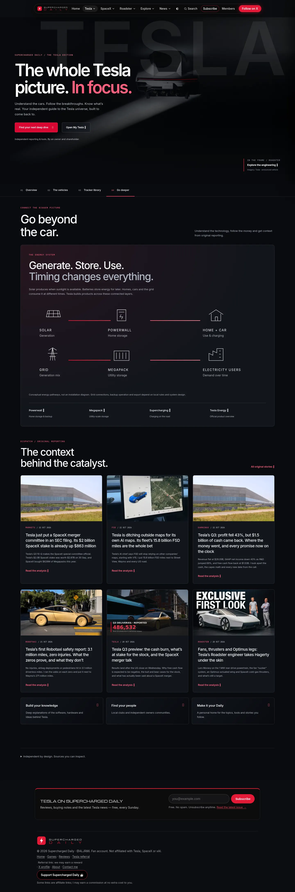

# Tesla overview studio

A complete redesign of `/tesla.html`, retaining the site navigation, brand, font families, theme control, newsletter, analytics, member integration and existing specialist destinations.

## Why it changed

The previous page mixed a long product directory, tracker cards and a large article list, with no useful distinction between the visitor's goals. The new page offers four clear sections and a consistent return path:

- **Overview:** owner/buyer/research routes, four carefully labelled briefing metrics, browser-local quick launch, visual features and quarterly operating charts.
- **The vehicles:** five selectable model-family profiles, review links, exact-car handoff to My Tesla, 3D explorers and a separate next-machine collection. Profiles deliberately avoid mixing trims, model years and regional range standards.
- **Tracker library:** 12 searchable, category-filtered tools. Star up to six shortcuts; unpin to replace one.
- **Go deeper:** original responsive energy diagrams, official product links, six newest Tesla stories, explainers and community routes.

## Visual system

Wide Tesla Roadster photography, oversized editorial typography, a ghosted Tesla word treatment, restrained crimson illumination, fine grid lines, iconography and consistent cards. Dark and light themes, responsive layouts at 320/390/768/1440 px, visible keyboard focus and reduced-motion rules. Hero media is eager with responsive AVIF; secondary imagery is lazy. No autoplay video, new third-party script, purchased font or paid service.

The Tesla page uses a new scoped stylesheet. `tesla-page.css` remains unchanged because Grok also uses it. The old `tesla-hub.js` remains available in the repository but is no longer bundled on this page. Generic intelligence/live scripts are no longer loaded on this page.

## Data and refresh

`node scripts/build-tesla-overview.mjs` reads the existing local source files, saves `/data/tesla-overview.json`, and renders complete semantic HTML. Browser rendering uses the same model and view modules; it fetches this local JSON once, retaining the saved copy after invalid, failed or older responses.

| Display | Source | Interpretation |
| --- | --- | --- |
| Quarterly figures and chart | `data/production.json` | Tesla IR production, delivery and storage deployment releases; original links on every table row |
| Newest sampled software | `updates-live.json` | Latest valid first-seen build with reporting cars; zero-count ghosts excluded; a Teslascope sample, not every Tesla |
| Listed EU markets | `data/fsd-europe.json` | Only `jurisdiction === EU` and `availability.status === listed`; not a legal approval count |
| Original stories | `data/articles.json` | Newest six `topic === tesla` records, publication dates retained |

The existing homepage build now calls this builder through `build-noscript.mjs` and commits the saved JSON. Existing hourly headline refresh also rebuilds and commits the Tesla page/snapshot. Production source edits trigger the homepage build. Refresh does not invent new IR releases: future quarterly records still need to be entered and sourced in `data/production.json`, as on the dedicated production tracker. Existing software/FSD acquisition workflows remain authoritative.

The last saved quarter in the initial redesign is Q3 2026, published 2 October: 464,391 produced, 486,532 delivered and 13.7 GWh storage deployed. Cross-checked against Tesla's public release and SEC exhibit. Chart axes start at zero; each metric has its own unit. Year-on-year calculation appears only with a matching prior-year quarter.

## Storage and privacy

`sd-tesla-overview-v1` stores only the selected model, chart metric and up to six tool IDs. It is browser-local, not Supabase/account sync. No VIN, location, Tesla account, new permission or personal record is read. Storage failure keeps controls usable for the visit. Preferences are validated and synchronized between browser tabs. No SQL or external setup needed.

Old `#lineup`, `#trackers`, `#robotaxi`, `#energy`, `#stock`, `#clubs`, `#news` and `#explorers` links route to a useful section. Without JavaScript or with the page bundle blocked, all sections, links, source tables and the saved briefing remain readable; inactive controls are hidden.

## Search and accessibility

Page-specific title/description, matching Open Graph and Twitter metadata, accurate image dimensions, canonical URL and CollectionPage/ItemList JSON-LD. One H1, semantic section headings, labelled search, pressed states on filters, polite status text, data tables and diagrams with accessible descriptions. This improves crawling; indexing or search ranking is never guaranteed.

## Sources and media

- [Tesla Q3 2026 production, deliveries and deployments](https://ir.tesla.com/press-release/tesla-third-quarter-2026-production-deliveries-and-deployments)
- [SEC-filed release](https://www.sec.gov/Archives/edgar/data/1318605/000162828026064366/exhibit991111111.htm)
- [Tesla FSD support](https://www.tesla.com/support/fsd): active driver supervision, configuration and regional limitations.
- [Tesla Powerwall](https://www.tesla.com/powerwall), [Megapack](https://www.tesla.com/megapack), [Energy](https://www.tesla.com/energy), [Supercharging](https://www.tesla.com/supercharger).

Existing image files and their original photographer/licence credits are retained in the source disclosure. Hero uses existing Tesla Roadster media. Diagrams and line icons are original code illustrations. Product imagery does not establish availability or endorsement.

## Validation

- Six Node tests: build determinism, semantic fallback preservation, chronological data/YoY, software ghost exclusion, malformed preferences, unsafe paths and source-text escaping.
- Twenty-nine browser cases: four sections at four widths; filters, no results, showroom persistence, pin limits, charts/table, old deep links, light theme, no JS, blocked bundle, blocked storage, malformed preferences, failed/malformed/older snapshots.
- Shared bundle tests and tracker snapshot tests.
- CI workflow uses the runner's existing Chrome through pinned Playwright 1.62.0.

## Previews

## Later decisions

- Account-synchronized shortcuts would need an explicit Supabase schema and conflict rules. Current storage is local by design and clearly labelled.
- A trim/market pricing feed would need a licensed, maintained source. No prices, range estimates, delivery dates or simulated live telemetry were added.
- Quarterly IR records still require a verified editorial update; automation can be considered separately.
